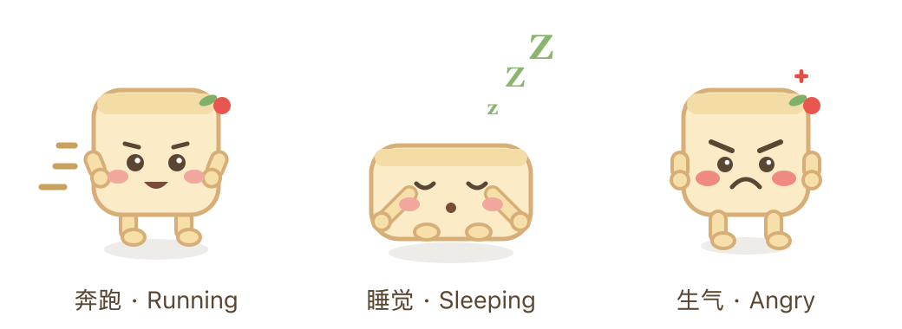

# 方糕萌宠 · Fanggao Pet

> 一只会跟着 DeepSeek Harness 对话状态变化的方糕萌宠：对话进行时奔跑、完成时躺下睡觉、出错时生气。可鼠标任意拖拽，位置自动记忆。



## 特性

- **三态动画**：由当前会话的 `SessionSnapshot` 实时驱动
  | 状态 | 触发条件 | 形象 |
  |------|----------|------|
  | 🏃 奔跑 | `running === true` | 上下弹跳 + 双腿交替摆动 + 速度线 |
  | 😴 睡觉 | 空闲 / 无报错 | 横躺、闭眼、头顶飘 `Z z z` |
  | 😡 生气 | `lastAgentError` / `promptError` / `openError` 存在，或 `openState === 'error'` | 竖眉、撇嘴、红脸、额头青筋脉冲 |
- **悬浮常驻**：渲染在 `shell.overlay` 帧级浮层，始终位于最上层，不占布局。
- **鼠标拖拽**：按住可拖到屏幕任意位置，位置存入 `localStorage`，刷新后保留。
- **永不遮断操作**：浮层本身 click-through，只有方糕本体响应指针事件。
- **纯 SVG + CSS 动画**：矢量、任意分辨率清晰、体积小、跟随时序流畅。

## 安装

本插件是 DeepSeek Harness 的本地 bundle（`@local/fanggao-pet`）：

1. 克隆仓库到本地：
   ```bash
   git clone https://github.com/gavinff1990/fanggao-pet.git
   ```
2. 在 Harness 中通过插件管理器安装该目录（绝对路径）：
   - 动作：`install_bundle`
   - 目标：`<克隆目录的绝对路径>`
3. 插件会立即激活并出现在页面右下角（默认位置）。

> 安装/卸载时插件管理器会重新链接该 bundle；修改 `client.js` 后重新安装即可热加载。

## 工作原理

- **Host 半**（`index.js`）无需逻辑，只负责注册 bundle。
- **Client 半**（`client.js`）：
  - 注入 `slots` + `sessions` 服务。
  - 订阅 `sessions.list` 找到当前主视图会话（`retainedBy.mainView > 0`）。
  - 订阅该会话的 `SessionFace`（`sessions.binding(id).session`）读取 `SessionSnapshot`，据此选出三种形态。
  - 通过 `ctx.slots.inject('shell.overlay', …)` 注册悬浮层条目，并用指针事件实现拖拽。

## 文件结构

```
fanggao-pet/
├── package.json        # bundle 清单（dsh.bundle.patch + dsh.client）
├── cordis.patch.yml    # 插入 fanggao-pet 插件行
├── index.js            # Host 半（空 apply）
├── client.js           # Client 半：SVG 萌宠 + 状态 + 拖拽
├── icon.svg            # 插件管理器中显示的图标
├── locale/{en,zh}.json # 插件标题/描述
└── docs/preview.png    # 形态预览
```

## 自定义

- **颜色/造型**：`client.js` 顶部的 `COLORS` 常量与 `runningPose` / `sleepingPose` / `angryPose` 三个函数。
- **拖拽记忆**：`STORE_KEY`（默认 `fanggao-pet.position`）。
- **默认位置**：`defaultPos()`（默认右下角）。

## FAQ / 排错

- **页面看不到方糕？** 确认插件已启用，且当前在主界面；它是 `shell.overlay` 条目，打开任意会话即可看到。
- **拖动没反应？** 指针要落在方糕本体上；它只占约 88×88 的区域，其余浮层区域是 click-through。
- **状态不切换？** 需要一个打开的会话；没有会话时默认显示睡觉。
- **想重置位置？** 清除 `localStorage` 键 `fanggao-pet.position` 后刷新。

## 许可

MIT，见 [LICENSE](LICENSE)。
